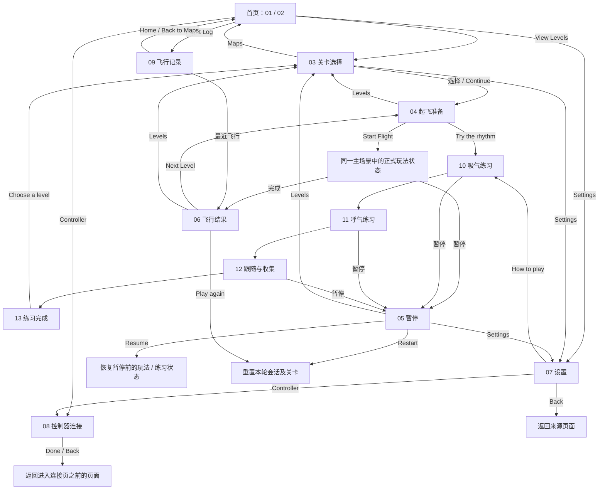

# 13 个 UI 页面与跳转设计

整理日期：2026-10-25。视觉依据为 [References](References/) 中 13 张用户提供的图；文件名、哈希与资源对应见 `Assets/Art/UI/UIAssetManifest.json`。下文将图中可直接确认的控件和根据业务补充的跳转规则分别说明。

## 页面目录

每个页面有独立 Prefab：`Assets/Prefabs/UI/Screens/{序号}_{名称}.prefab`。

| 序号 / 名称 | 原参考 | 主要区域 | 入口与离开 |
| --- | --- | --- | --- |
| 01 HomeDashboard | 01 Home / with taskbar | 世界选择、顶部导航、Today's Flight、连接状态 | View Levels→03；Flight Log→09；Settings→07；Controller→08 |
| 02 HomeClean | 02 Home / no taskbar | 无今日任务栏的首页布局变体 | View Levels→03；顶部入口同 01 |
| 03 LevelSelect | 03 Levels / Darumadrop One | 12 张关卡卡、选中信息、状态图例、Continue | Maps→首页；Settings→07；选择关卡/Continue→04 |
| 04 ReadyForTakeoff | 04 Ready for takeoff | 连接/姿势检查、时长卡、节奏曲线 | Levels→03；Try the rhythm→10；Start Flight→正式玩法入口 |
| 05 FlightPaused | 05 Flight paused | 中央暂停面板、当前进度、角色半身像 | Resume→暂停前状态；Restart→本轮起点；Levels→03；Settings→07 |
| 06 FlightComplete | 06 Flight complete | 用时、循环与节奏成绩、今日进度、下一关 | Next Level→下一关04；Levels→03；Play again→当前关重开 |
| 07 Settings | 07 Settings / centered / no IP | Audio、Display、Support | Back→来源页面；Controller→08；How to play→10；Language 为配置接口 |
| 08 ControllerConnection | 08 Controller connection | 控制器插图、状态、电量、信号、检查按钮 | Check Connection→硬件检查接口；Done/Back→来源页面 |
| 09 FlightLog | 09 Flight Log | 连续天数、周飞行、时长、周历、最近飞行 | Home/Back to Maps→首页；最近条目→历史结果详情（复用06布局） |
| 10 PracticeInhale | 01 · Inhale / descend | 暂停/步骤/星星顶栏、下降引导、吸气提示 | 完成本练习→11；Pause→05 |
| 11 PracticeExhale | 02 · Exhale / ascend | 上升引导、呼气提示 | 完成本练习→12；Pause→05 |
| 12 PracticeFollow | 03 · Follow / collect | 纸鹤路径、星星、收集反馈 | 完成本练习→13；Pause→05 |
| 13 PracticeComplete | 04 · Practice complete | 收集数量、完成面板、Choose a level | Choose a level→03；完成后顶部 Pause 禁用 |

01 和 02 是同一个逻辑“首页”的两种展示状态。没有完成记录时使用 02；有飞行或练习记录时使用 01。参考只有 Windbell Forest，因此左右世界按钮不可交互。

## 导航图



导航图中的业务流程现已接到主场景。正式飞行复用 12 页顶栏，隐藏参考背景与示例路径，显示真实关卡。练习 10→11 由实际输入保持时间推进，12→13 由新收集 3 个星星或会话结束推进。

## Unity 场景与层级

这些跳转以 UI 页面状态切换实现，**不为 13 个 UI 新建 13 个游戏场景**。正式游戏仍使用统一主场景和 `BreathLevelManager`，通过现有的关卡 Prefab 根对象 `SetActive` 切关。UI、公共摄像机、输入接收器位于关卡根对象之外。

```text
Main runtime scene
├─ GameRoot / BreathLevelManager / ArduinoBreathInput
├─ Shared camera, lighting, EventSystem
├─ LevelRoot / Level prefab instances  [最多一个激活]
└─ Shared Canvas / UIFlowRoot
   ├─ 页面导航与返回来源
   ├─ 首页 / 选关 / 起飞准备 / 结果 / 设置 / 记录
   └─ 练习 HUD / 暂停覆盖层
```

`Assets/Scenes/BreathDemo.unity` 是实际游戏入口，公共 `GameUI` 持有 `UIFlowRoot.prefab` 实例与业务绑定；没有增加构建场景。`Assets/Scenes/UI/UIFlowPreview.unity` 继续作为独立设计验收入口。两者任意时刻只有一页 UI 激活。正式暂停/设置保留当前关卡对象与会话，冻结缩放时间和管理器推进；继续时恢复暂停前的时间倍率。

Canvas 使用 1920×1080 缩放基准，各页面通过 `UIPageViewport` 将参考稿布局等比居中放入实际窗口；背景独立铺满。覆盖 16:9、16:10、4:3 和超宽窗口，详见 [窗口适配说明](../../Development/UIViewportLayout.md)。

## 返回与生命周期规则

- Settings 和 Controller 保存进入来源：Home→Settings→Controller→Back→Settings→Back→Home。
- Pause 保存暂停前的具体练习阶段/正式玩法状态；进入 Settings 再返回不会重建关卡或重连串口。
- Resume 恢复原进度；Restart 通过现有统一关卡管理器重置；Levels 走会话退出清理。
- Next Level 先更新所选关卡，再进入 Ready；锁定关卡不能开始。
- 离开页面时解除控件临时订阅；`UIRouteButton`、`UISliderValue`、`UIToggleValue` 在 OnDisable 退订，避免反复开关造成重复回调。
- Reduce Motion 关闭可选入场、轨道补间倾斜和引导角色脉冲；保留必要的飞行运动和呼吸输入。现有 PrimeTween 用于轨道运动，不增加新的动画依赖。

## 正式运行绑定

`BreathUIFlowController` 处理会话与导航，`UIScreenRouter` 处理页面和返回栈，`BreathLevelManager` 仍是唯一关卡切换入口。实际场景关闭 `referencePreviewMode`、预览快捷键及 R/N/数字切关快捷键。Escape 在飞行时暂停，在暂停页继续，在设置/控制器页返回来源。

- 首页→选关→准备→起飞，实际关卡数量来自 `WingSingerLevelCatalog`；现有 First Flight 与 Slow Breath 两关均为初始可选，卡片关联原有场景中的关卡 Prefab 实例及各自参数 SO。12 个参考卡位保留布局，未配置的关卡保持禁用，末关结果页禁用 Next Level。后续关卡可以通过定义 SO 配置初始开放或顺序解锁。
- 正式起飞与练习均使用同一管理器、玩家和 USB 接收器。暂停、设置返回和重开不重连串口。退出关卡清空会话、关闭关卡根对象并停止收集反馈。
- 暂停页显示实际完成循环和时间进度；结算读取会话时长、收集数、循环和节奏匹配百分比。一次会话只保存一次结果。历史结果仅查询，点击 Play again 才创建新会话。
- 循环数为准备阶段后已经经过的完整呼吸周期数；节奏百分比为正确轨道停留秒数 / 已经过的目标直线停留秒数，不把转轨和准备时间计入分母。星星数取实际收集数。
- 练习吸气要求保持上轨，呼气要求保持下轨，持续时间来自当前关卡配置；错误输入会重置当前保持计时。跟随阶段要求新增 3 个收集；若会话先结束，按实际数量完成本次练习。生产版禁用点击提示板/Space 跳步。
- `FlightProgressStore` 以 PlayerPrefs 的 `WingSinger.Progress.v1` 保存最多 128 条近期记录、解锁与设置；时间保存为 UTC，周统计按本地周一到今天计算，日期和连续天数按本地日历。练习计入今日活动/周时长，不计入已完成飞行数。每日目标为 6 次，是当前产品配置口径。
- 控制器页读取真实串口连接与样本新鲜度，Check Connection 调用现有接收器重连。USB 协议未提供电量，显示 `--`，连接类型显示 USB。没有新鲜硬件样本时允许已启用的 W/S 后备输入；传感器已连接但样本过期时保持中轨并阻止新起飞。无效阈值同样阻止起飞。
- 音乐/音效滑条保存独立音量并作用于 `UIFlowBindings` 中指定的 AudioSource 数组；当前场景尚无音乐和音效资源。高对比开关加深界面文字；语言页仍只提供 English，没有新增翻译内容。
- 全部 UI Button 使用 PrimeTween 提供悬停、按下和回弹反馈，使用非缩放时间，暂停时也可播放。Reduce Motion、按钮禁用及页面关闭会取消缩放并恢复原始变换。配置与新增关卡流程见 [UI 交互与关卡目录](../../Development/UIInteractionsAndLevelCatalog.md)。

编辑器菜单 `WingSinger > UI > Connect Navigation to Gameplay` 可重建主场景绑定，会先在 `Temp/NavigationBackup` 保留首次接线前的场景副本。不会变更第三方插件、关卡资源、渲染档位或构建列表。页面参考 Prefab 保留示例数据，主场景通过实例覆盖添加实际数据绑定。

## 独立参考预览行为

`UIScreenRouter` 管理 13 个页面根对象和有上限的返回栈；`UIRouteButton` 统一处理导航。首页、选关、设置、控制器页、暂停/返回、练习四步和结果页面在预览中可以走通。点击练习底部提示板或按 Space 推进，Escape 暂停/返回。

仅独立预览场景使用 `referencePreviewMode=true`：Start Flight 发出事件并借用 12 的示例完成链；不开始真实关卡。主场景由业务处理器接管路由。

独立预览的滑条/开关只演示控件状态；实际保存、游戏设置和设备重连由主场景绑定处理。

## 接入时必须统一的设计差异

| 参考设计 | 当前工程事实 | 接入决定 |
| --- | --- | --- |
| Inhale descend / Exhale ascend | 现有输入默认 ≤400 吸气上轨、≥1000 呼气下轨 | 实际页面统一为吸气 UP、呼气 DOWN，保留已有硬件映射；独立参考画廊保留原稿。 |
| 蓝牙、电量82%、Signal Good、Connected | 当前 ESP32 协议仅 USB 串口原始 ADC，无 BLE、电量、无线信号字段 | 图中值仅样例；正式页应显示 USB、实际连接/新鲜度，对未知电量显示未提供，不从 ADC 推算电量。 |
| 12 关、Level4 Gentle Breeze | 当前只有两个示例关卡 Prefab | 实际标题与数量取真实数据，只有已解锁的真实关卡可交互。 |
| Rhythm matched、周统计、连续天数 | Session 提供时间、正确轨道时长与收集数 | 由上文的计算口径和本地持久化服务提供。 |
| WindSinger Logo | 项目与协议名 WingSinger | Logo 按原稿保留，内部命名继续 WingSinger。 |

Settings 原图下方 How to play 超出 Support 边框；实现将其移回面板内部，保留原区块和文案。

## 验收入口

- 页面参考：[References](References/)。
- 实际 Unity 截图：[Previews](Previews/)。
- 验证报告：[UIBuildValidation.json](../../Validation/UIBuildValidation.json)。
- 实际运行验证：[UIPlayValidation.json](../../Validation/UIPlayValidation.json)。
- 正式导航验证：[GameplayNavigationValidation.json](../../Validation/GameplayNavigationValidation.json)；[主场景运行截图](RuntimePreviews/)。该验证使用模拟 USB 传输，不替代 ESP32 实物测试。
- 素材说明：[UIAssetGuide](../../Art/UIAssetGuide.md)。
