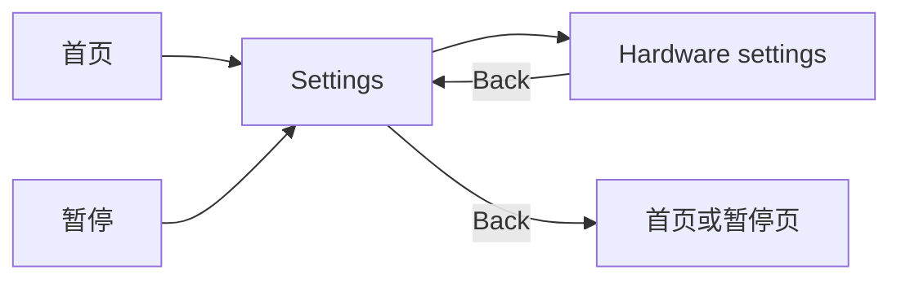

# 硬件配置资源、游戏内设置与 ADC HUD

更新：2026-10-29。

## 配置在哪里

- 工程默认配置：`Assets/Settings/Input/WingSingerHardwareSettings.asset`，类型为 `BreathSensorSettings`。在 Project 选中它即可编辑设备名、地址、UUID、模式、滤波、映射阈值、超时和调试开关。
- `BreathDemo > GameRoot > ArduinoBreathInput` 现在只引用上述配置资源，保留键盘输入引用和运行状态显示，不再把整组参数序列化在场景中。
- 游戏入口：`Settings > Hardware settings`。该入口使用 Settings 中原来禁用的 Language 占位行，原 Controller 状态页仍保留。
- 游戏内保存文件：`Application.persistentDataPath/HardwareInput.json`。当前 Windows 项目路径为 `%USERPROFILE%/AppData/LocalLow/DefaultCompany/WingSinger/HardwareInput.json`。首次保存才创建该文件，不使用 PlayerPrefs 储存硬件参数。字段示例见 [HardwareInput.example.json](HardwareInput.example.json)。

## 加载、保存与恢复

输入组件先复制配置资源的默认值，再加载版本匹配且有效的本机 JSON。运行时只修改副本，不修改共享 SO 或场景资产。文件损坏、参数无效或版本不支持时，保留默认值并在 Console 给出原因。

游戏内点击 `Apply & save` 会先验证完整配置，再写临时文件并替换 JSON；验证或保存失败时保持原配置。中心基准、偏差、USB 阈值、数据新鲜度、Console 开关和键盘后备直接生效；设备、协议、滤波数量和接收器时序等连接参数变更时重连一次。`Reconnect` 使用已应用的参数，未提交的输入框内容不会生效。`Restore defaults` 从工程 SO 恢复并保存到本机，不改工程默认资源。

离开页面不会提交草稿；重新进入时显示当前生效配置。编辑工程 SO 后需要重新进入 Play；已有本机配置优先于 SO，需要从游戏内恢复默认值才能采用新的默认设置。

## 页面内容

新页面 Prefab：`Assets/Prefabs/UI/Screens/14_HardwareSettings.prefab`。保留原 13 张参考图对应页面，新增第 14 个生产设置页面。页面复用现有通用 UI 素材、PrimeTween 按钮交互、1920×1080 Canvas 与 `UIPageViewport` 等比布局。

- 实时信息：设备名、连接类型、协议、地址、Service / Notify UUID、连接阶段和错误、样本是否新鲜。
- 原始 ADC、滤波均值、Unity 判定、固件压差和固件状态；陈旧或断线后不把旧数值当成实时数据。
- 可调项：连接类型、CSV/旧 UART 协议、名称、地址、中心、偏差、滤波数量、超时/重试、USB 阈值/端口、Console 调试和键盘后备。UUID 在本页展示，默认资源中可以编辑。
- 配套当前硬件协议及判定依据见 [BluetoothInput.md](BluetoothInput.md)。

从暂停菜单进入 Settings 和硬件页会保持原游戏会话暂停，BLE 后台继续接收。逐级返回 Settings、Pause 后点击 Resume 才恢复游戏；不创建新场景或新关卡实例。

## 游戏 HUD

原游戏 HUD 的 `BLE connected` 位置现在显示两行，例如 `ADC 1300 mV` 和 `默认`。有效低/高值分别显示 `吸气` / `呼气`；CSV 判定使用最近 N 个通知的均值，ADC 行显示原始值，与实际输入来自同一接收器。没有新鲜样本时显示 `ADC -- mV` 和 `默认`，不会把键盘后备伪装成硬件测量值。连接详情保留在设置/控制器页面。

中文状态使用独立静态 SDF 字形图集 `HardwareStatus SDF.asset`，只包含“吸气默认呼”五个字形；运行包不依赖目标电脑安装字体。

## 验证入口

- `dotnet run --project Tools/SensorInputTests/SensorInputTests.csproj -c Release`：输入、滤波、映射、配置副本、JSON 保存/恢复/损坏回退。
- `WingSinger > Validate Bluetooth Input`：正式场景内用模拟通知验证硬件页、保存/恢复、错误输入、HUD 三态、暂停与返回，并生成多尺寸截图。测试写入 `Temp/HardwareSettingsValidation/HardwareInput.json`，不接触真实用户的配置或存档。
- `WingSinger > UI > Validate Responsive Viewports`：14 页的窗口、实际控件和文字边界验证。
- `WingSinger > UI > Install Hardware Settings`：定向接入或补齐配置资源引用、新页面和 HUD；保留其他 UI 与关卡修改，不重新生成原 13 页。

以上软件模拟检查不代表真实 BLE 连接、传感器方向或实际阈值已校准。
